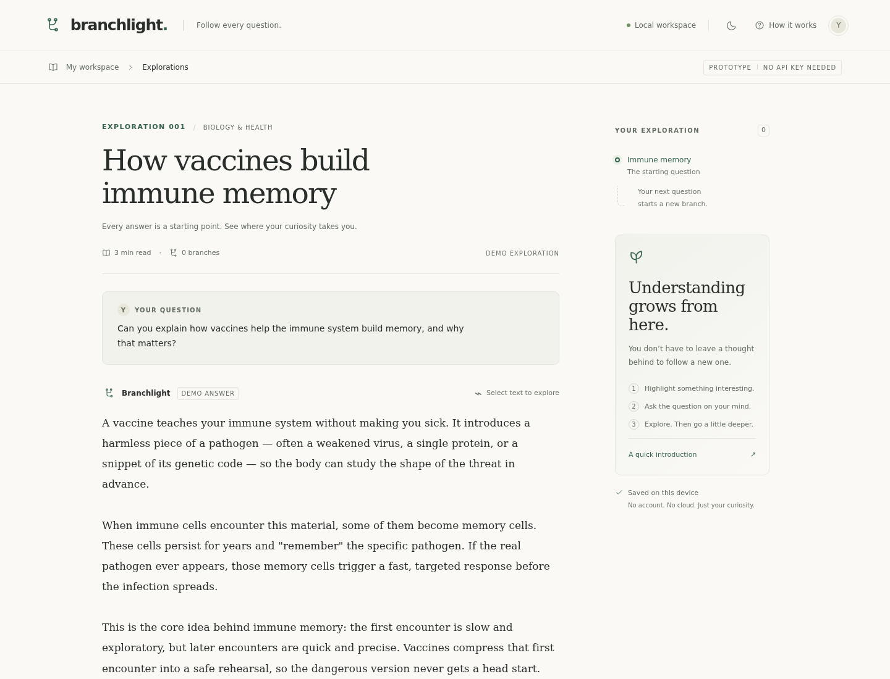

# branchlight.

### Follow every question.

An answer is a starting point, not the end of a conversation. **Select a passage inside a demo explanation, ask about it, and follow the answer in a connected branch. Then branch from that answer, too.**



## Status — milestone 1, local mock prototype

The **browser interaction is implemented and tested**. An Electron desktop shell is included and type-checked, with unit-tested security configuration and asset routing. **Native Electron launch/restart is not verified in this environment**: its runtime download is blocked, and the Linux sandbox has no desktop display. This is not a signed installer or a production release, and the full desktop acceptance gate remains open.

No API key, account, GPU, database server, or paid service is required. Installation downloads free dependencies; normal use after installation is local. All answers are **scripted mock content**, not live AI or medical advice.

## Run it

Install **Node.js 22.12 or later** (Node 22 LTS recommended), then open a terminal in this folder:

```bash
npm ci
npm run dev
```

Open **http://localhost:5173** in a modern browser. Keep this terminal open; press Ctrl+C to stop. The development server also supports Arena’s live preview. Use the same address each time to keep the same browser workspace.

### Desktop target — Electron

On a machine with a graphical desktop:

```bash
npm ci
npm run desktop:install   # one-time free Electron runtime download
npm run desktop           # builds the UI + shell, then opens Electron
```

Electron 45 uses an explicit runtime-install command. If the download is blocked by your network, the browser prototype remains available. Linux also needs the normal Electron/Chromium system libraries and a display; do not disable the application sandbox to work around OS setup issues.

The desktop shell loads only the bundled production UI from `branchlight://app/`; it does **not** need a running Vite server. Browser and desktop workspaces are separate. No installer, code signing, auto-update, or deployment has been added.

### Production browser check

```bash
npm run build
npm run preview
```

Open **http://localhost:4173**. Production has a local-only content security policy. Development permits Vite’s local hot-reload connection.

## A two-minute demo

1. Read **How vaccines build immune memory**.
2. Mouse/trackpad-select **A vaccine** inside the explanation. Click **Ask about this**.
3. The composer retains the exact excerpt. Type **Explain this simply**, then **Add branch** (or Ctrl/⌘+Enter). Cancel/Escape creates nothing.
4. Find the connected branch beneath its parent answer. The source passage is highlighted; the branch repeats it as a clickable source quote. It is **not a new main-chat message**.
5. Select **record of invaders** inside that answer and ask **Give me an example**.
6. Select **virus X** in the new answer and ask **Why does this matter?**.
7. At the third visible level, choose **Continue in focus view**. The answer gets full reading width with breadcrumbs. Text in focus view is selectable too; keep branching.
8. **Back to parent context** returns one level; **← Conversation** returns to the explanation and restores its previous scroll position during this session.
9. **Collapse**, reload, then **Expand**. The questions, answers, anchors, relationships, and collapsed/focused state remain.
10. Toggle the theme, try a narrow window, or export a JSON copy from the footer. **Reset demo** requires explicit confirmation.

### Keyboard path

- Tab to **Choose a passage** beneath any answer, press Enter, then choose a paragraph.
- Type a question; Ctrl/⌘+Enter submits. Tab/Shift+Tab stay within the open dialog. Escape cancels and returns focus.
- For an existing native text selection, **Ctrl/⌘+Shift+B** opens the composer.
- Focus, collapse, expand, source links, breadcrumbs, help, export, and reset are buttons/links with visible focus styles.
- The paragraph picker is the pointer-free alternative; arbitrary word-level keyboard selection depends on the browser/OS’s text-selection/caret-browsing support.

## Test it

```bash
npm test                  # domain, component, selection and desktop-policy tests
npm run typecheck         # renderer, desktop, tooling and E2E TypeScript
npm run lint              # actual ESLint, including hook rules
npm run format:check
npm run build
npm run build:desktop
npm audit

# Browser E2E, normal workstation setup:
npx playwright install chromium
npm run test:e2e          # builds production, starts preview, runs Playwright
```

On Linux you may need Playwright’s documented system dependencies (`npx playwright install --with-deps chromium`); installing OS packages may require administrator permission. The test suite uses isolated browser profiles and does not reset your personal workspace.

For this restricted Linux sandbox, where browser CDNs/system packages are unavailable:

```bash
SANDBOX_CHROMIUM=1 npm run test:e2e
```

That optional test path uses the locked `@sparticuz/chromium` npm binary, unpacks its bundled libraries into ignored `.cache/`, and runs headlessly. Its container-specific `--no-sandbox` flag is **test-only**, never used by the Electron application. It requires Linux x65 and `tar`. Generated traces, screenshots, browser libraries and builds are ignored by Git.

**Verified in this session:** 65 unit/component/policy tests and 9 real-browser E2E tests, plus type checking, ESLint, formatting, production UI build and desktop TypeScript build. See [the verification report](docs/VERIFICATION.md) for exact scope, red/green history, acceptance mapping and remaining checks. Automated accessibility checks found no tagged WCAG A/AA violations in the tested reading/composer states in both themes; this is **not** a full accessibility certification.

## What is built

- A paper-and-pine reading interface: serif explanations, restrained green accents, light/dark tokens, reduced-motion support and responsive layouts.
- Native text selection, a viewport-constrained contextual toolbar, frozen-draft composer, cancellation and duplicate-submission guards.
- Persistent UTF-16 anchors, exact-text source highlights, clickable source return and overlapping/multiple branches.
- Recursive branching without a model depth limit. Two inline levels are rendered; deeper nodes become focus gateways instead of endlessly shrinking text.
- Full-width focus mode, ancestor breadcrumbs, direct parent return, and per-context in-session scroll restoration.
- A live exploration outline, keyboard paragraph picker, local JSON export and confirmation-gated reset.
- Recoverable broken-anchor states; visible persistence errors; corrupt/unknown stored data is protected rather than silently overwritten.
- A minimal isolated Electron shell, kept separate from the branching domain.

## Architecture and decisions

| Concern     | Choice                                | Reason                                                                                                                     |
| ----------- | ------------------------------------- | -------------------------------------------------------------------------------------------------------------------------- |
| Domain      | Plain TypeScript                      | Stable anchors and tree transitions can be tested without React or Electron.                                               |
| UI          | Existing React 18.3.1                 | Preserves the working demo; no major UI-framework migration is needed for this slice.                                      |
| Tooling     | Vite 8, Vitest 5, TypeScript          | Updated compatible locked versions; the inherited audit findings are resolved. Requires Node 22.12+.                       |
| Desktop     | Electron 45                           | The originally requested target, with an offline production renderer. Runtime verification is still outstanding.           |
| Persistence | `StorageLike` + localStorage          | Small single-device prototype, no backend/native SQL dependency. Electron stores it in the persistent application session. |
| Styling     | CSS tokens and component classes      | Visuals can change independently of domain and selection logic. No UI framework or remotely loaded fonts.                  |
| Tests       | Testing Library, Playwright, axe-core | Domain invariants, component integration, native browser behavior and automated accessibility checks.                      |

The `StorageLike` boundary allows later replacement with a desktop file/SQLite repository. Current saves are synchronous, local, per-origin and **not encrypted**. Browser storage can be removed by the user/browser and has a quota; exports are useful but are not a managed backup service. Exports currently have **no import UI**. On unreadable data, export preserves the original blob for recovery; new temporary work is not written over it. Reset explicitly releases that protection.

### Important source files

```text
src/domain/                 model, immutable transitions, anchor validation, mock responder
  store.ts                  storage boundary, persistence and recovery protection
  validation.ts             runtime schema/topology checks for saved data
src/selection/              native Selection/Range → stable UTF-16 offsets
src/components/
  SelectableText.tsx        immutable text + segmented source marks
  SelectionProvider.tsx     selection → draft → persisted branch
  SelectionOverlay.tsx      contextual action and composer
  BranchView.tsx            connected branches and bounded-depth gateways
  FocusView.tsx             readable deep-context navigation
  ui/Modal.tsx              focus containment and restoration
src/context.tsx             store, theme and selection registry
src/index.css               palette, typography, component states and breakpoints
src/App.tsx                 view switching and reading-position memory
desktop/                    Electron process, fixed-origin asset policy and policy tests
tests/e2e/                  production-build Playwright and axe checks
docs/                       verification, architecture/security notes and screenshot
```

### Anchoring contract

A content block has immutable text, a stable ID and a version. Each branch stores its own ID, parent content ID, parent version, inclusive `start` and exclusive `end`, exact selected text, surrounding context, question, answer content, children, timestamps, and collapsed state.

Offsets count **JavaScript UTF-16 code units**, not visual glyphs, bytes or Unicode code points. DOM `Range.toString().length` and JS `slice(start, end)` use that same convention. Unicode/emoji tests cover surrogate pairs and accented/non-Latin text. Source marks preserve `textContent` exactly. Overlapping anchors are segmented into a union of highlights, not nested/mutated source strings.

Every load validates parent identity, version, exact substring and ownership. An invalid anchor disables source navigation and shows **Anchor unavailable**, but keeps the question/answer. Structural corruption (such as cycles, missing child links or an unsupported schema) instead opens a temporary sample session with a warning, leaving the original storage blob untouched.

This milestone supports plain text, including paragraph-spanning selections **within one content block**. Selections across separate answers or chrome are rejected; crossing answer boundaries explains why. Rich text, documents, editing and regeneration are not implemented. Existing answer text must not be edited without an explicit version/migration strategy.

## Limitations and next step

- **Desktop acceptance is not closed:** native Electron launch/restart, native menus, desktop export, OS zoom/resize, and OS-specific storage paths still need a real desktop check. No signed/package installer was built.
- Browser tests ran on headless Chromium/Linux, not Safari, Firefox, Windows or macOS. Real trackpad gestures, touch selection, screen readers and high-contrast OS modes still need manual testing.
- Source-connected branches sit beneath the owning answer, not between individual sentences. Persistent highlights, source quotes and source-return controls provide the connection; rich paragraph-slot rendering is a future layout option.
- Scroll positions are remembered per context **within the running UI**, not across a process restart; branch/focus/collapse state does persist. Layout changes/collapse can naturally clamp scroll position.
- Drafts are intentionally not persisted. Responses are synchronous scripted examples; the composer guards submission, but there is no simulated network delay or fabricated streaming state.
- The prototype has one exploration, no search, document upload, real LLM, API keys, voice, diagrams, notes, accounts, cloud sync or hosted services.
- Synchronous whole-workspace saves and cloned domain transitions are suitable for this small prototype, not a demonstrated large-data solution. No throughput benchmark is claimed.

**Next small step:** run the documented desktop walkthrough on the founder’s laptop and do a short usability session with students before adding providers. See [architecture/security notes](docs/ARCHITECTURE.md) for future seams; those future capabilities are planned, not built.

## Research and licensing

Official source documentation/licenses were checked through GitHub and npm metadata on 2026-11-26; there was no general unrestricted browsing. References and security assumptions are recorded in [architecture/security notes](docs/ARCHITECTURE.md). React, Vite, Vitest and Electron use MIT licensing; Playwright uses Apache-2.0. Shipping Electron requires retaining its bundled Chromium/third-party notices. No name clearance, domain purchase or trademark claim is made. The repository’s declared MIT license is retained; founder ownership/licensing policy should be confirmed before public product distribution.
